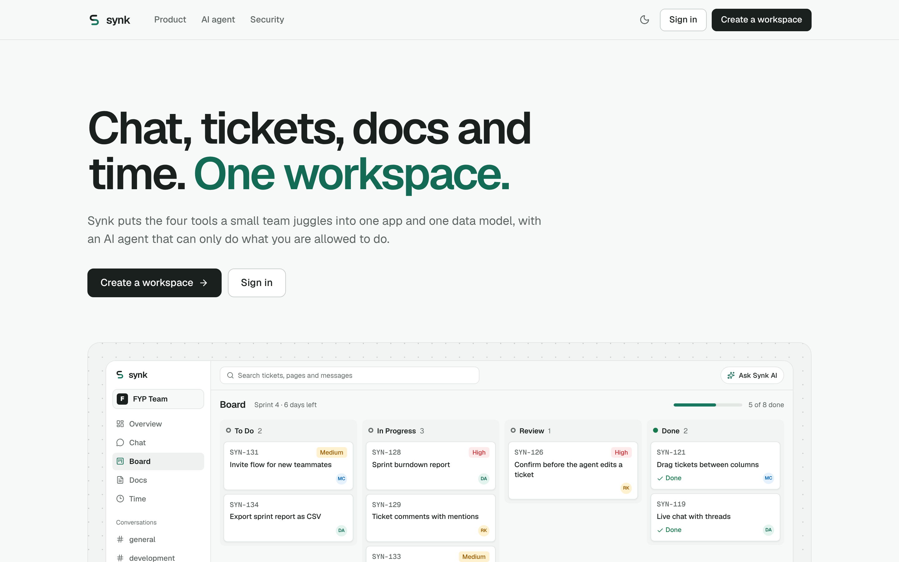
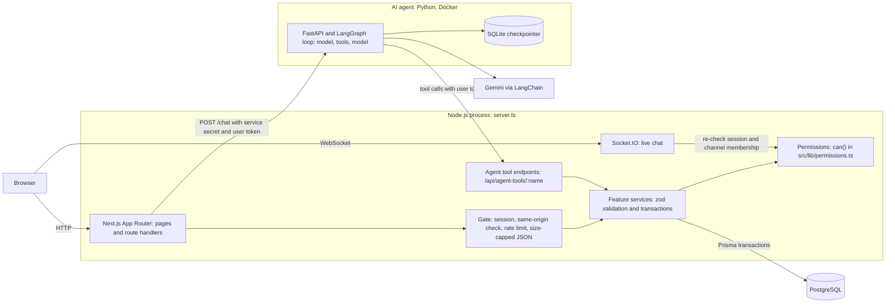

# Synk

**A team workspace that combines chat, issue tracking, docs and time tracking in one data model, with an AI agent that can only do what the signed-in user is allowed to do.**

[](https://github.com/Hazammm/SYNK/actions/workflows/chat-ci.yml)

## Abstract

Small teams usually split their work across a chat tool, an issue tracker, a wiki and a timesheet. Each one has its own accounts, permissions and search. Synk puts these four modules in one Next.js application backed by one PostgreSQL schema, so a ticket key in a chat message, a Markdown page or an AI reply points to the same record. Every single-resource access check, whether it comes from a browser request, a live socket or an AI tool call, goes through one permission function, and ticket and page list and search queries apply the same rule (workspace membership plus a project-access row) as database filters; message search covers only channels the user has joined. The AI agent, Synk AI, is a separate Python LangGraph service that uses Google Gemini. It has no database credentials. It acts only by calling Synk's own tool endpoints with a short-lived token that names one user and one workspace, and it asks for explicit confirmation before it changes existing data.

## Key ideas

- **One permission function for people and the agent.** `can(action, facts)` in [`src/lib/permissions.ts`](src/lib/permissions.ts) checks the workspace role (ADMIN / MEMBER), channel membership and per-project access (No access / Can view / Can edit). Checks run inside the same Prisma transaction as the write. Agent tool calls go through the same services and access rules, so the agent never has more access than its user.
- **The agent has no credentials of its own.** It never receives `DATABASE_URL` or `NEXTAUTH_SECRET`. Each turn, Next.js signs a 5-minute HMAC token for one user, workspace and conversation, and the agent sends it back with every tool call. Every call that reaches a Synk tool, including dry-run previews and denials, is written to an `ActionLog` table.
- **Confirmation before changing existing data.** `update_ticket` first runs as a dry run. The graph then pauses with LangGraph `interrupt()` and shows each field's old and new value until the user clicks Confirm or Cancel. If a name matches more than one record, the tool returns `ambiguous` with the candidates and the agent asks which one the user means.
- **Non-disclosure.** If you cannot access a ticket, page or project, Synk gives the same not-found answer it gives for one that does not exist. This holds for the agent's replies too.
- **Live delivery re-checks every recipient.** Chat messages are saved over REST and then published over Socket.IO. Each recipient's session and channel membership are checked again at publish time, so a revoked user stops receiving messages. A client UUID makes retries safe.
- **Security.** Sessions are revocable: NextAuth JWTs are backed by `LoginSession` rows, sign-out ends the current session, a password change ends every other session, and a password reset ends them all, dropping the matching live sockets. Removing someone from a workspace removes their live channel subscriptions. Invite and reset tokens are single-use and stored only as hashes. Browser writes need an exact Origin match (the Google invite-acceptance route relies on a SameSite=Lax, HttpOnly profile cookie instead), and rate limits are applied per user and per IP.

## Interface

The interface has a light and a dark theme built on one token set, a public landing page, and a shell with a collapsible sidebar. 

| Landing Page| 
|---|
|  | 

## Architecture



| Component | Stack |
|---|---|
| Web app and API | Next.js 16.4.1 (App Router), React 19.3, NextAuth 4.24 (JWT strategy), zod 4.6, Node.js 22.12 or later |
| Realtime | Socket.IO 4.8.4 on the same `node:http` server ([`server.ts`](server.ts)) |
| Data | PostgreSQL 16, Prisma 6.19.3 (27 models, 10 migrations) |
| Agent | Python 3.13, FastAPI, LangGraph 1.2, langchain-google-genai 4.5, run in Docker as a non-root user |
| Email | Mailtrap (API or SMTP) for invites, welcome mail and password reset |

- **Request path.** A route handler calls the shared gate, then a feature service (`src/features/*/service.ts`). The service validates input with zod and checks access inside the transaction that does the write. Errors are mapped to JSON responses in one place ([`src/lib/errors.ts`](src/lib/errors.ts)).
- **Agent path.** Next.js calls the agent's `POST /chat` with a shared service secret, the user token and a context limited to what the caller can already see. The agent calls back `POST /api/agent-tools/:name` with that token. Model memory is kept in a SQLite checkpointer. The readable transcript is stored in PostgreSQL.

## What Synk does

| Module | Capabilities |
|---|---|
| Workspaces | 3-step "Create your workspace" wizard. Joining an existing workspace is invite-only, through emailed links that expire after 7 days and work once. ADMIN / MEMBER roles. Email and password sign-in, plus Google, GitHub and Bitbucket when configured |
| Chat | Public and private channels, one-level threads, live delivery with a Live / Reconnecting indicator, typing indicators, cursor-paged history, retry-safe sends, ticket keys shown as links |
| Issue tracking | Per-project access, several boards per project with editable columns, drag and drop with mouse, touch or keyboard, four filters, comments with @mentions, sprints with one active per project |
| Reports | Burndown with an ideal line, velocity over the last 6 completed sprints, status and assignee breakdowns, CSV export |
| Docs | Nested Markdown pages per project, formatting toolbar and preview, clickable checklists, edit-conflict protection, PostgreSQL full-text search |
| Code hosts | GitHub and Bitbucket repositories linked to a project. A pull request that names a ticket key in its title or branch appears on that ticket with its status, kept current by signed webhooks or a manual sync. A merged pull request offers to move the ticket to Done |
| Time | One running timer per person (server clock, 24-hour cap), manual entries, a weekly report by day, ticket and person, CSV export |
| Overview and alerts | Your open, overdue and recently completed tickets, active sprints, and in-app alerts for assignments, comments and mentions. Each alert type can be turned off |
| Synk AI | Five tools: `create_ticket`, `update_ticket` (needs confirmation), `find_tickets`, `create_doc` and `search_workspace`. Each reply lists the actions it took, with links |


## Quickstart

Requirements: Node.js 22.12 or later, npm, and Docker (for PostgreSQL and the optional agent).

```bash
npm ci
cp .env.example .env            # PowerShell: Copy-Item .env.example .env
node -e "console.log(require('crypto').randomBytes(32).toString('base64'))"
# Paste the output into NEXTAUTH_SECRET in .env (at least 32 characters).
docker compose up -d --wait postgres
npm run db:generate
npm run db:migrate
npm run dev
```

Open http://localhost:3000 and choose **New to Synk? Create a workspace**. Use `npm run dev` or `npm start`, not `next start`: the custom server hosts Socket.IO.

**Optional AI agent.** In `.env`, set `AI_SERVICE_URL=http://127.0.0.1:8000`, `AI_SERVICE_SECRET` (at least 32 characters) and `GOOGLE_API_KEY`, then run `npm run agent:up`. Without these settings the rest of Synk works normally, and the panel says the assistant is not set up.

**Checks.**

```bash
npm run lint
npm run typecheck
npm test                     # unit tests
npm run build
npm run agent:test           # agent tests in Docker, no API key needed
```

## Synk AI in practice

The turn below is illustrative. The tool names and the quoted messages come from the code; the ticket is an example.

```text
User:   Move the dark mode ticket to Review
Model:  find_tickets(query="dark mode")                  -> SYN-14, status In Progress
Model:  update_ticket(ticket="SYN-14", status="Review")   dry run: Status In Progress -> Review
Graph:  interrupt(); the panel shows "Confirm this change" with Confirm and Cancel
Synk:   "Please confirm this change before I make it."
User:   clicks Confirm; Next.js signs a new token and the graph resumes
Graph:  the tools step re-runs from the top, repeating the dry run, then makes the change
Model:  update_ticket(ticket="SYN-14", status="Review")   "Updated SYN-14: status In Progress → Review."
Panel:  Actions taken, with a link to SYN-14; open boards reload
Audit:  4 ActionLog rows: find_tickets, update_ticket (dry run), update_ticket (dry run, repeated on resume), update_ticket
```

Now suppose the user asks "Assign SYN-12 to Sarah" in a project with two members named Sarah. The dry run returns `ambiguous` with both names, the graph does not pause, and the agent asks which Sarah the user means.

**Accuracy.** On the PRD's 30-prompt test set (15 happy path, 5 ambiguity, 5 permission denial, 5 edge cases), the agent scored 30 of 30 with `gemini-3.5-flash-lite`, against a target of 90%. See [`docs/ai-agent-eval.md`](docs/ai-agent-eval.md).

## Trade-offs

| Decision | What it buys | What it costs |
|---|---|---|
| Next.js and Socket.IO in one custom process | One origin, one Prisma client, the same permission code for HTTP and sockets | No `next start`, no serverless hosting, a single instance only |
| Database is authoritative; publish after commit | A failed live delivery never turns a saved write into an error | Delivery is at-least-once; clients reload history after reconnecting |
| JWT plus a database `LoginSession` row | Real sign-out and server-side revocation | One session lookup per request |
| Agent acts only through HTTP tool endpoints | No agent credentials; the same checks and audit for every action | An extra network hop per tool call |
| Optimistic doc versions instead of co-editing | No collaborative-editing infrastructure | Two people editing one page at once get a conflict message |

## Repository layout

```text
server.ts                 Custom Node server: Next.js and Socket.IO on one port
src/
  app/                    App Router pages (/w/[workspaceId]/...) and API route handlers
  components/             App shell, sign-in page, profile menu
  features/               Domain services and UI: chat, projects, tickets, reports, docs, time,
                          workspaces, notifications, overview, search, account, agent
  lib/                    Permissions, auth, sessions, validation, rate limits, tokens
  server/socket.ts        Socket.IO authentication, rooms and per-recipient re-checks
  proxy.ts                Next.js 16 proxy: sign-in redirects for pages
prisma/                   Schema, migrations and an opt-in demo seed
agent/
  synk_agent/             FastAPI app, LangGraph graph, tool specs, prompt
  tests/                  pytest suite with a scripted model and a fake Synk API
  evals/                  30-prompt accuracy evaluation and scorer
tests/                    Unit, integration and Playwright end-to-end tests
docs/                     Setup guide, module design notes, the evaluation report and screenshots
.github/workflows/        CI: agent pytest job and the web verify job
compose.yaml              PostgreSQL and the agent service for local development
```

## Documentation

| Document | Contents |
|---|---|
| [`docs/setup.md`](docs/setup.md) | Environment variables, email, OAuth sign-in, seed data, testing, production runtime |
| [`docs/ai-agent.md`](docs/ai-agent.md) | Agent design, security model, tools, how to add a tool |
| [`docs/ai-agent-eval.md`](docs/ai-agent-eval.md) | Evaluation method, how to run it, results and limits |
| [`docs/issue-tracking.md`](docs/issue-tracking.md) | Projects, boards, sprints, the access model and how reports are calculated |
| [`docs/docs-module.md`](docs/docs-module.md) | Markdown pages, rendering, conflict handling, search |
| [`docs/time-tracking.md`](docs/time-tracking.md) | Timers, manual entries, weekly reports |
| [`docs/testing.md`](docs/testing.md) | Results against the PRD quality targets: coverage, the denial suite, response times, the timed walkthrough |
| [`docs/code-hosts.md`](docs/code-hosts.md) | GitHub and Bitbucket: linking repositories, pull requests on tickets, webhooks |
| [`docs/chat-implementation.md`](docs/chat-implementation.md) | Original chat design notes (API table and roadmap predate later modules) |
| [`docs/chat-qa.md`](docs/chat-qa.md) | Chat verification records and manual acceptance plan |

## License

This repository includes MIT license.
